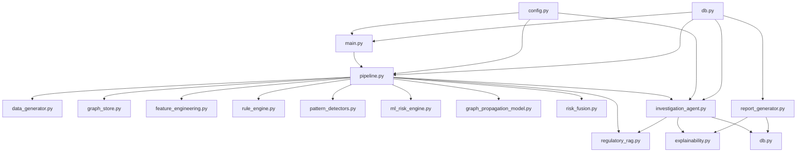
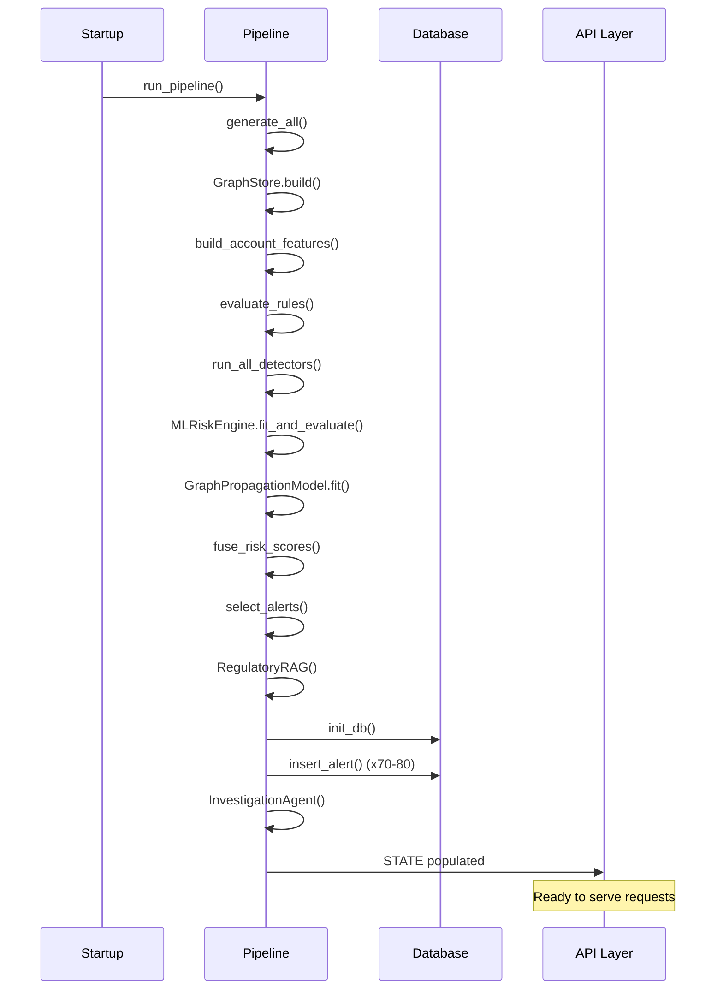

# Backend Architecture

> **AegisGraph — Backend Architecture Deep Dive**
> System design, module interactions, and implementation patterns

---

## Table of Contents

1. [Architecture Overview](#1-architecture-overview)
2. [System Context](#2-system-context)
3. [Module Architecture](#3-module-architecture)
4. [Pipeline Design](#4-pipeline-design)
5. [API Design](#5-api-design)
6. [Data Model](#6-data-model)
7. [Agent Architecture](#7-agent-architecture)
8. [Risk Engine Design](#8-risk-engine-design)
9. [Graph Processing](#9-graph-processing)
10. [Storage Strategy](#10-storage-strategy)
11. [Security Architecture](#11-security-architecture)
12. [Extensibility](#12-extensibility)

---

## 1. Architecture Overview

AegisGraph follows a **layered pipeline architecture** with clear separation of concerns. Each module has a single responsibility and exposes a stable interface, enabling independent testing and upgrade.

```
┌─────────────────────────────────────────────────────────────────────┐
│                        API Gateway Layer                            │
│                  (FastAPI + CORS + Static Files)                    │
├──────────┬──────────┬──────────┬──────────┬──────────┬──────────────┤
│          │          │          │          │          │              │
│  Module  │  Module  │  Module  │  Module  │  Module  │   Module     │
│  Layer   │  Layer   │  Layer   │  Layer   │  Layer   │   Layer      │
│          │          │          │          │          │              │
│ Data Gen │  Graph   │ Feature  │  Rule +  │   ML +   │  Pattern     │
│          │  Store   │Engineering│  Graph   │ GNN-lite │Detectors     │
├──────────┴──────────┴──────────┴──────────┴──────────┴──────────────┤
│                       Fusion + Agent Layer                          │
│                    (Risk Fusion + Investigation Agent)              │
├─────────────────────────────────────────────────────────────────────┤
│                     Application Layer                               │
│         (RAG + Explainability + Report Generation)                  │
├─────────────────────────────────────────────────────────────────────┤
│                      Persistence Layer                              │
│                    (SQLite + Audit Ledger)                          │
└─────────────────────────────────────────────────────────────────────┘
```

### Architectural Principles

| Principle | Implementation |
|-----------|---------------|
| **Single Responsibility** | Each module handles one concern |
| **Interface Stability** | Public methods remain constant across upgrades |
| **Dependency Inversion** | Modules depend on abstractions, not implementations |
| **Fail-Safe Fallbacks** | Deterministic fallbacks for all AI components |
| **Audit Everything** | Every significant action is logged |
| **Zero External Dependencies** | MVP runs entirely offline |

---

## 2. System Context

### Deployment Topology

```
┌─────────────────────────────────────────────────────────────────────┐
│                            Docker Host                              │
│  ┌─────────────────────────────────────────────────────────────┐   │
│  │                    Docker Compose                            │   │
│  │  ┌─────────────────────────────────────────────────────────┐ │   │
│  │  │  aegisgraph-api Container                               │ │   │
│  │  │  ┌───────────────────────────────────────────────────┐ │ │   │
│  │  │  │  FastAPI (Uvicorn)                                │ │ │   │
│  │  │  │  ┌─────────────┐  ┌─────────────┐  ┌───────────┐ │ │ │   │
│  │  │  │  │ API Routes  │  │  Pipeline   │  │ Frontend  │ │ │ │   │
│  │  │  │  │             │  │  (in-mem)   │  │ (static)  │ │ │ │   │
│  │  │  │  └─────────────┘  └─────────────┘  └───────────┘ │ │ │   │
│  │  │  │  ┌─────────────┐  ┌─────────────┐               │ │ │   │
│  │  │  │  │  SQLite     │  │   Graph     │               │ │ │   │
│  │  │  │  │  Database   │  │  (NetworkX) │               │ │ │   │
│  │  │  │  └─────────────┘  └─────────────┘               │ │ │   │
│  │  │  └───────────────────────────────────────────────────┘ │ │   │
│  │  └─────────────────────────────────────────────────────────┘ │   │
│  └─────────────────────────────────────────────────────────────┘   │
└─────────────────────────────────────────────────────────────────────┘
```

### External Dependencies (MVP)

| Dependency | Purpose | Optional |
|------------|---------|----------|
| Python 3.13 | Runtime | Required |
| FastAPI | Web framework | Required |
| Uvicorn | ASGI server | Required |
| SQLite3 | Database | Required |
| Anthropic SDK | Agentic AI | Optional |
| OpenAI SDK | Agentic AI (fallback) | Optional |

---

## 3. Module Architecture

### Module Dependency Graph



### Module Contracts

Each module exposes a stable interface:

| Module | Input | Output | Side Effects |
|--------|-------|--------|--------------|
| `data_generator` | Config params | DataFrames | None |
| `graph_store` | DataFrames | GraphStore instance | None |
| `feature_engineering` | Graph + transactions | Feature DataFrame | None |
| `rule_engine` | Features + accounts | Rules DataFrame | None |
| `ml_risk_engine` | Training data | Model + metrics | None |
| `pattern_detectors` | Graph + transactions | Pattern flags | None |
| `risk_fusion` | Three score series | Fused DataFrame | None |
| `regulatory_rag` | Query string | Ranked results | Loads corpus |
| `investigation_agent` | Graph + features + RAG | Report dict | Logs to audit |
| `report_generator` | Investigation result | Markdown report | None |
| `db` | Various | Records | SQLite writes |

---

## 4. Pipeline Design

### PipelineState Pattern

The pipeline uses a singleton state object to avoid recomputation:

```python
class PipelineState:
    def __init__(self):
        self.customers_df = None
        self.accounts_df = None
        self.tx_df = None
        self.graph_store = None
        self.features_df = None
        self.rules_df = None
        self.pattern_flags = None
        self.pattern_findings_raw = None
        self.risk_df = None
        self.ml_metrics = None
        self.rag = None
        self.agent = None

STATE = PipelineState()  # Module-level singleton
```

**Rationale**: The pipeline runs once at startup. All subsequent API requests read from `STATE`, avoiding redundant computation.

### Pipeline Execution Flow



### Rebuild Endpoint

The `/api/rebuild` endpoint allows runtime pipeline regeneration:

```python
@app.post("/api/rebuild")
def rebuild(inject_evasion: bool = False):
    run_pipeline(inject_evasion=inject_evasion)
    return {"status": "ok", "num_alerts": len(db.list_alerts())}
```

---

## 5. API Design

### RESTful Conventions

| Convention | Implementation |
|------------|---------------|
| Resource naming | Plural nouns (`/api/alerts`, `/api/cases`) |
| Nested resources | `/api/cases/{case_id}/review`, `/api/cases/{case_id}/audit` |
| Status codes | 200, 404, 400, 503 |
| Request body | Pydantic models for POST requests |
| Response format | JSON with consistent structure |

### CORS Configuration

```python
app.add_middleware(
    CORSMiddleware,
    allow_origins=["*"],      # Restrict in production
    allow_credentials=True,
    allow_methods=["*"],
    allow_headers=["*"],
)
```

### Static File Serving

```python
FRONTEND_DIR = os.path.join(
    os.path.dirname(os.path.dirname(os.path.dirname(
        os.path.abspath(__file__)))), "frontend", "out"
)
if os.path.isdir(FRONTEND_DIR):
    app.mount("/", StaticFiles(directory=FRONTEND_DIR, html=True), name="frontend")
```

**Rationale**: Mounts the built Next.js frontend at the root, eliminating CORS for the demo deployment.

### Request Validation

```python
class ReviewDecision(BaseModel):
    decision: str   # "approve" | "reject" | "escalate"
    notes: str = ""

@app.post("/api/cases/{case_id}/review")
def review_case(case_id: str, decision: ReviewDecision):
    if decision.decision not in ("approve", "reject", "escalate"):
        raise HTTPException(400, "decision must be approve, reject, or escalate")
```

---

## 6. Data Model

### In-Memory DataFrames

The pipeline produces these pandas DataFrames:

| DataFrame | Columns | Size | Purpose |
|-----------|---------|------|---------|
| `customers_df` | customer_id, name, country, risk_score | 260 | Customer metadata |
| `accounts_df` | account_id, customer_id, type, country | 400 | Account metadata |
| `tx_df` | tx_id, sender, receiver, amount, timestamp | ~2350 | Transactions |
| `features_df` | account_id, velocity, in_degree, ... | 400 | Behavioral features |
| `rules_df` | account_id, rule_score, triggered_rules | 400 | Rule engine output |
| `pattern_flags` | account_id → list of findings | 400 | Pattern detection |
| `risk_df` | account_id, rule_score, ml_score, ... | 400 | Fused risk scores |

### Graph Data Structure

```python
class GraphStore:
    def __init__(self):
        self.graph = nx.DiGraph()  # NetworkX directed graph
    
    def build(self, customers_df, accounts_df, tx_df):
        # Nodes: accounts with attributes
        # Edges: transactions with attributes
        # Returns: self.graph
    
    def expand_network(self, account_id, hops=3):
        # BFS expansion up to N hops
        # Returns: subgraph
    
    def to_cytoscape_json(self, subgraph):
        # Convert to Cytoscape.js format
        # Returns: {"elements": [...]}
```

### Graph Attributes

**Node Attributes**:
```python
{
    "account_id": "ACC-001",
    "account_type": "individual",
    "country": "US",
    "risk_level": "HIGH",
    "opened_date": "2024-01-15"
}
```

**Edge Attributes**:
```python
{
    "tx_id": "TX-001",
    "amount": 15000.00,
    "currency": "USD",
    "timestamp": "2024-06-15T10:30:00Z",
    "rel_type": "TRANSACTION"
}
```

---

## 7. Agent Architecture

### Dual-Mode Design

```mermaid
flowchart TD
    A[investigate() called] --> B{USE_LLM_AGENT?}
    B -->|No| C[_investigate_deterministic]
    B -->|Yes| D{API Available?}
    D -->|No| C
    D -->|Yes| E{Provider?}
    E -->|Anthropic| F[_investigate_agentic_anthropic]
    E -->|Groq/OpenRouter| G[_run_openai_investigation_loop]
    F --> H{Success?}
    G --> H
    H -->|No| C
    H -->|Yes| I[_assemble_result]
    C --> I
    I --> J[Return report]
```

### Tool Registry Pattern

```python
AGENT_TOOL_SCHEMAS = [
    {
        "name": "get_account_profile",
        "description": "...",
        "input_schema": {"type": "object", "properties": {}, "required": []},
    },
    # ... 7 more tools
]

class InvestigationAgent:
    def __init__(self, ...):
        self.tools = {
            "get_account_profile": self.tool_get_account_profile,
            "expand_network": self.tool_expand_network,
            # ... 6 more
        }
    
    def _execute_tool(self, tool_name, account_id, tool_input, gathered):
        # Dispatches to deterministic Python function
        # Never allows arbitrary actions
```

### Safety Mechanisms

| Mechanism | Implementation | Purpose |
|-----------|---------------|---------|
| Budget cap | `AGENT_MAX_TOOL_CALLS = 10` | Prevent runaway loops |
| Minimum evidence | `_ensure_minimum_evidence()` | Backfill required fields |
| Graceful fallback | Try/except → deterministic | Never crash on LLM failure |
| Fixed tool surface | `AGENT_TOOL_SCHEMAS` only | No arbitrary actions |
| Evidence-only summaries | System prompt constraint | No hallucinated facts |

### Agentic Loop (OpenRouter/Groq)

```python
for iteration in range(max_tool_calls):
    response = client.chat.completions.create(
        model=model_name,
        messages=messages,
        tools=openai_tools,
        tool_choice="auto",
    )
    
    tool_calls = response.choices[0].message.tool_calls
    if not tool_calls:
        break  # Model stopped voluntarily
    
    for tool_call in tool_calls:
        result = self._execute_tool(tool_call.function.name, ...)
        messages.append({
            "role": "tool",
            "tool_call_id": tool_call.id,
            "content": json.dumps(result)
        })
```

---

## 8. Risk Engine Design

### Three-Signal Fusion

```python
def fuse_risk_scores(rule_scores, ml_scores, graph_scores):
    FUSION_WEIGHTS = {"rule": 0.30, "ml": 0.40, "graph": 0.30}
    combined = (
        FUSION_WEIGHTS["rule"] * rule_scores +
        FUSION_WEIGHTS["ml"] * ml_scores +
        FUSION_WEIGHTS["graph"] * graph_scores
    )
    return combined
```

### Risk Level Assignment

```python
def select_alerts(fused_scores):
    HIGH_RISK_THRESHOLD = 0.60
    alerts = fused_scores[fused_scores >= HIGH_RISK_THRESHOLD]
    alerts["risk_level"] = alerts["combined_risk"].apply(
        lambda x: "HIGH" if x >= 0.60 else ("MEDIUM" if x >= 0.30 else "LOW")
    )
    return alerts
```

### ML Model Training

```python
class MLRiskEngine:
    def __init__(self):
        self.model = RandomForestClassifier(
            n_estimators=100,
            max_depth=10,
            random_state=42,
            class_weight="balanced"  # Handle imbalanced data
        )
    
    def fit_and_evaluate(self, training_df):
        X = training_df.drop("label", axis=1)
        y = training_df["label"]
        X_train, X_test, y_train, y_test = train_test_split(
            X, y, test_size=0.25, stratify=y, random_state=42
        )
        self.model.fit(X_train, y_train)
        y_pred = self.model.predict(X_test)
        y_proba = self.model.predict_proba(X_test)[:, 1]
        return compute_metrics(y_test, y_pred, y_proba)
```

### GNN-lite Implementation

```python
def propagate_features(graph, features_df, hops=3):
    """NumPy-based message passing."""
    node_features = features_df.to_dict("index")
    for hop in range(hops):
        new_features = {}
        for node in graph.nodes():
            neighbors = list(graph.neighbors(node))
            if neighbors:
                neighbor_avg = np.mean([
                    list(node_features[n].values()) for n in neighbors
                ], axis=0)
                new_features[node] = neighbor_avg
        node_features.update(new_features)
    return pd.DataFrame.from_dict(node_features, orient="index")
```

---

## 9. Graph Processing

### Graph Store Operations

| Operation | Algorithm | Complexity |
|-----------|-----------|------------|
| `build()` | Node/edge insertion | O(V + E) |
| `expand_network()` | BFS traversal | O(V + E) |
| `to_cytoscape_json()` | Graph serialization | O(V + E) |
| Pattern detection | DFS + topology analysis | O(V × E) |

### Network Expansion

```python
def expand_network(self, account_id, hops=3):
    subgraph = nx.ego_graph(self.graph, account_id, radius=hops, undirected=True)
    return subgraph
```

**Note**: Uses NetworkX's `ego_graph` for efficient ego-network extraction.

### Pattern Detection Algorithms

| Pattern | Algorithm | Complexity |
|---------|-----------|------------|
| Funnel | In-degree + temporal clustering | O(V log V) |
| Fan-out | Out-degree + temporal clustering | O(V log V) |
| Layering | Chain detection (DFS) | O(V + E) |
| Smurfing | Multi-source aggregation | O(V × E) |
| Circular flow | Cycle detection (Johnson's) | O((V + E)(V log V)) |

---

## 10. Storage Strategy

### Database Layer

```python
class Database:
    def __init__(self, db_path=config.DB_PATH):
        self.conn = sqlite3.connect(db_path, check_same_thread=False)
        self.conn.row_factory = sqlite3.Row
    
    def init_db(self, reset=False):
        if reset:
            self.conn.executescript("DROP TABLE IF EXISTS ...")
        self.conn.executescript("""
            CREATE TABLE IF NOT EXISTS alerts (...)
            CREATE TABLE IF NOT EXISTS cases (...)
            CREATE TABLE IF NOT EXISTS audit_log (...)
        """)
```

### Data Retention

| Table | Retention | Cleanup Strategy |
|-------|-----------|-----------------|
| `alerts` | Indefinite | None (append-only) |
| `cases` | Indefinite | None (append-only) |
| `audit_log` | Indefinite | None (append-only) |

**Rationale**: Compliance requires permanent retention. In production, implement partitioning for large datasets.

### Query Patterns

```python
# List all alerts with optional status filter
def list_alerts(self, status=None):
    query = "SELECT * FROM alerts"
    params = []
    if status:
        query += " WHERE status = ?"
        params.append(status)
    return self.conn.execute(query, params).fetchall()

# Get audit trail for a case
def get_audit_trail(self, case_id):
    return self.conn.execute(
        "SELECT * FROM audit_log WHERE case_id = ? ORDER BY timestamp",
        (case_id,)
    ).fetchall()
```

---

## 11. Security Architecture

### Authentication & Authorization

| Layer | Current | Production |
|-------|---------|------------|
| API Auth | None (development) | OAuth2 / JWT |
| Role-based Access | localStorage | Server-side RBAC |
| Data Isolation | Single tenant | Multi-tenant with row-level security |

### Input Validation

```python
from pydantic import BaseModel, validator

class ReviewDecision(BaseModel):
    decision: str
    
    @validator("decision")
    def validate_decision(cls, v):
        if v not in ("approve", "reject", "escalate"):
            raise ValueError("Invalid decision")
        return v
```

### Secrets Management

```python
# config.py
GROQ_API_KEY = os.environ.get("GROQ_API_KEY")
OPENROUTER_API_KEY = os.environ.get("OPENROUTER_API_KEY")
ANTHROPIC_API_KEY = os.environ.get("ANTHROPIC_API_KEY")

# .env (never committed)
GROQ_API_KEY=gsk_...
OPENROUTER_API_KEY=sk-or-...
```

### SQL Injection Prevention

All database queries use parameterized statements:

```python
# Safe
self.conn.execute("SELECT * FROM alerts WHERE alert_id = ?", (alert_id,))

# Never used
self.conn.execute(f"SELECT * FROM alerts WHERE alert_id = {alert_id}")
```

---

## 12. Extensibility

### Module Upgrade Path

Each module is designed for drop-in replacement:

```python
# Current: NetworkX
class GraphStore:
    def __init__(self):
        self.graph = nx.DiGraph()

# Production: Neo4j
class GraphStore:
    def __init__(self, uri, auth):
        self.driver = GraphDatabase.driver(uri, auth=auth)
    
    def build(self, customers_df, accounts_df, tx_df):
        # Same public interface, different implementation
```

### Plugin Architecture

The Investigation Agent's tool registry is a dictionary:

```python
self.tools = {
    "get_account_profile": self.tool_get_account_profile,
    "expand_network": self.tool_expand_network,
    # Add new tools here without changing the agent loop
}

def register_tool(self, name, function):
    self.tools[name] = function
```

### Configuration-Driven Behavior

All thresholds and parameters are in `config.py`:

```python
# Change behavior without code changes
FUSION_WEIGHTS = {"rule": 0.30, "ml": 0.40, "graph": 0.30}
HIGH_RISK_THRESHOLD = 0.60
AGENT_MAX_TOOL_CALLS = 10
```

---

## Operational Considerations

### Startup Time

| Phase | Duration | Optimization |
|-------|----------|--------------|
| Data generation | ~2s | Can be cached |
| Graph building | ~1s | Incremental updates possible |
| ML training | ~5s | Model persistence |
| Pipeline total | ~10s | Parallelize where possible |

### Memory Usage

| Component | Peak Memory | Notes |
|-----------|-------------|-------|
| DataFrames | ~50MB | All in-memory |
| Graph (NetworkX) | ~20MB | 400 nodes, 2350 edges |
| ML Model | ~5MB | RandomForest with 100 trees |
| Agent State | ~10MB | Per investigation |

### Scaling Considerations

| Bottleneck | Current | Solution |
|------------|---------|----------|
| Single-threaded pipeline | Sequential execution | Parallelize independent phases |
| In-memory state | Process-bound | Redis shared state |
| SQLite writes | Serialized connection | Connection pooling |
| Single container | Monolith | Microservice split |

---

*This document covers the current backend implementation. For API specifications, see [Technical Documentation](./technical-documentation.md).*
