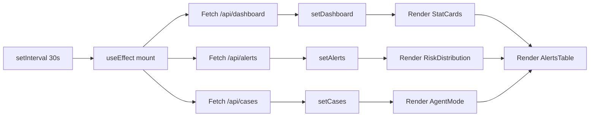
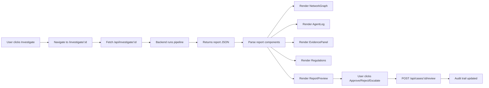

# Frontend & UI/UX Documentation

> **AegisGraph — Frontend Architecture and User Experience**
> Design system, component architecture, and interaction patterns

---

## Table of Contents

1. [Overview](#1-overview)
2. [Technology Stack](#2-technology-stack)
3. [Design System](#3-design-system)
4. [Architecture](#4-architecture)
5. [Page Breakdown](#5-page-breakdown)
6. [Component Library](#6-component-library)
7. [Data Flow](#7-data-flow)
8. [State Management](#8-state-management)
9. [Visual Design](#9-visual-design)
10. [Accessibility](#10-accessibility)
11. [Performance](#11-performance)

---

## 1. Overview

AegisGraph's frontend is a modern, responsive web application built with Next.js 16 and React 19. It provides two primary interfaces:

- **Dashboard**: Alert queue, risk metrics, ML performance, agent status
- **Investigation Workspace**: Graph visualization, evidence panel, regulatory context, report review

### Key Principles

- **Dark-first design**: Optimized for long analyst sessions
- **Data-dense but breathable**: Maximum information with clear hierarchy
- **Responsive**: Works on desktop, tablet, and mobile
- **Real-time updates**: Auto-refreshing dashboards via polling
- **Role-aware**: UI adapts based on user role (Analyst vs. Senior Reviewer)

---

## 2. Technology Stack

| Technology | Version | Purpose |
|------------|---------|---------|
| Next.js | 16.3.3 | React framework, App Router |
| React | 19.2.8 | UI library |
| Tailwind CSS | 4 | Utility-first styling |
| Cytoscape.js | 3.28.0 | Network graph visualization |
| Lucide React | 0.400.0 | Icon system |
| Geist / Outfit | Latest | Typography |

### Why This Stack?

- **Next.js 16**: Latest React features, App Router, built-in optimizations
- **Tailwind CSS 4**: Rapid UI development, consistent design tokens
- **Cytoscape.js**: Industry-standard graph visualization with excellent performance
- **Lucide**: Consistent, accessible iconography
- **No heavy state library**: React hooks sufficient for current complexity

---

## 3. Design System

### Color Palette

```
Primary Background:    #050510 (Deep space black)
Surface:               rgba(255, 255, 255, 0.02) - 0.05
Border:                rgba(255, 255, 255, 0.05) - 0.10

Accent — Cyan:          #06b6d4 (Primary actions, highlights)
Accent — Cyan Dark:     #0891b2 (Hover states, borders)
Accent — Purple:        #8b5cf6 (Secondary metrics)
Accent — Emerald:       #10b981 (Success, approved)
Accent — Amber:         #f59e0b (Warnings, medium risk)
Accent — Rose:          #f43f5e (Danger, high risk)

Text Primary:           #ffffff
Text Secondary:         #e2e8f0
Text Muted:             #94a3b8
Text Subtle:            #64748b
```

### Typography

| Font | Usage |
|------|-------|
| **Outfit** (display) | Headings, brand, UI labels |
| **Geist Sans** (body) | Paragraphs, general text |
| **Geist Mono** (code) | IDs, numbers, code blocks |

### Spacing Scale

Based on Tailwind's default scale: 4px base unit (1 = 4px)

| Token | Value | Usage |
|-------|-------|-------|
| `px-1` | 4px | Tight spacing |
| `px-2` | 8px | Icon padding, compact elements |
| `px-3` | 12px | Button padding |
| `px-4` | 16px | Standard padding |
| `px-6` | 24px | Section padding |
| `px-8` | 32px | Large containers |

### Elevation System

| Class | Effect | Usage |
|-------|--------|-------|
| `glass-card` | `bg-white/[0.02] border border-white/5 backdrop-blur` | Primary cards |
| `glass-card` + hover | `hover:border-cyan-500/30` | Interactive cards |

---

## 4. Architecture

### App Router Structure

```
frontend/
├── app/
│   ├── layout.js              # Root layout (fonts, theme)
│   ├── page.js                # Dashboard (main entry)
│   ├── globals.css            # Global styles, animations
│   ├── investigate/[id]/page.js  # Investigation workspace
│   └── monitoring/page.js     # Model drift monitoring
├── components/
│   ├── Header.jsx             # Global navigation header
│   └── NetworkGraph.jsx       # Reusable graph component
└── package.json
```

### Routing Strategy

| Route | Component | Purpose |
|-------|-----------|---------|
| `/` | `page.js` | Main dashboard |
| `/investigate/[id]` | `page.js` | Investigation workspace |
| `/monitoring` | `page.js` | Model drift and MLOps view |

### Data Fetching Strategy

```javascript
// Client-side polling with React hooks
useEffect(() => {
  fetchData();
  const interval = setInterval(fetchData, 30000); // 30s refresh
  return () => clearInterval(interval);
}, []);
```

---

## 5. Page Breakdown

### 5.1 Dashboard (`/`)

The main operational view for compliance analysts.

```
┌──────────────────────────────────────────────────────────────────┐
│ Header (Logo + Navigation + Role Selector)                       │
├──────────────────────────────────────────────────────────────────┤
│                                                                  │
│  ┌─────────────┐ ┌─────────────┐ ┌─────────────┐ ┌──────────┐ │
│  │ Total       │ │ Transactions│ │ Active      │ │ Cases    │ │
│  │ Accounts    │ │ Count       │ │ Alerts      │ │ Done     │ │
│  │   ~400      │ │  ~2,350     │ │  ~75        │ │  ~12     │ │
│  └─────────────┘ └─────────────┘ └─────────────┘ └──────────┘ │
│                                                                  │
│  ┌────────────────────────────────┐ ┌─────────────────────────┐ │
│  │ Risk Distribution             │ │ Agent Mode              │ │
│  │ ┌────────┐ ┌────────┐ ┌─────┐│ │ ● Agentic (LLM-planned) │ │
│  │ │ HIGH   │ │ MEDIUM │ │ LOW ││ │                         │ │
│  │ │   45   │ │   20   │ │  5  ││ │ Recent Activity:        │ │
│  │ └────────┘ └────────┘ └─────┘│ │ CASE-A1B2 → ACC-001   │ │
│  │                              │ │ CASE-C3D4 → ACC-042   │ │
│  │ ML Performance:              │ │ CASE-E5F6 → ACC-103   │ │
│  │ Precision: 60.0%             │ └─────────────────────────┘ │
│  │ Recall: 40.0%                │                             │
│  │ F1: 50.0%                    │                             │
│  └────────────────────────────────┘                             │
│                                                                  │
│  ┌──────────────────────────────────────────────────────────┐   │
│  │ Alerts Queue                                              │   │
│  │ ┌──────────┬───────────┬────────┬──────┬──────────────┐  │   │
│  │ │ Alert ID │ Account   │ Risk   │ Score│ Action       │  │   │
│  │ ├──────────┼───────────┼────────┼──────┼──────────────┤  │   │
│  │ │ALERT-001 │ ACC-001   │ HIGH   │ 76%  │ Investigate →│  │   │
│  │ │ALERT-002 │ ACC-042   │ MEDIUM │ 45%  │ Investigate →│  │   │
│  │ │ALERT-003 │ ACC-103   │ LOW    │ 22%  │ Investigate →│  │   │
│  │ └──────────┴───────────┴────────┴──────┴──────────────┘  │   │
│  └──────────────────────────────────────────────────────────┘   │
└──────────────────────────────────────────────────────────────────┘
```

**Key Interactions**:
- "Rebuild Pipeline" button regenerates synthetic data and reruns detection
- "Inject Adversarial Evasion" checkbox adds sophisticated evasion patterns
- Clicking "Investigate" navigates to investigation workspace
- Stats auto-refresh every 30 seconds

### 5.2 Investigation Workspace (`/investigate/[id]`)

The primary analysis interface for compliance investigators.

```
┌──────────────────────────────────────────────────────────────────┐
│ Header                                                           │
├──────────────────────────────────────────────────────────────────┤
│                                                                  │
│  Account: ACC-001  │  Risk: HIGH (76%)  │  Status: INVESTIGATING │
│                                                                  │
│  ┌─────────────────────┐  ┌──────────────────────────────────┐  │
│  │                     │  │  Agent Activity Log              │  │
│  │   Network Graph     │  │  ─────────────────────────────  │  │
│  │                     │  │  [10:42] Loading profile...     │  │
│  │   (Cytoscape.js)    │  │  [10:42] Expanding network...   │  │
│  │                     │  │  [10:42] Detecting patterns...  │  │
│  │   • Nodes colored   │  │  [10:42] Running risk models... │  │
│  │     by risk level   │  │  [10:42] Found: funnel, layering │  │
│  │   • Edges show      │  │  [10:43] Retrieving regs...    │  │
│  │     amounts         │  │  [10:43] Generating report...   │  │
│  │   • Interactive     │  │  [10:43] Investigation complete │  │
│  │     pan/zoom        │  │                                  │  │
│  └─────────────────────┘  └──────────────────────────────────┘  │
│                                                                  │
│  ┌─────────────────────┐  ┌──────────────────────────────────┐  │
│  │  Evidence Panel     │  │  Regulatory Context              │  │
│  │                     │  │                                  │  │
│  │  Rules Triggered:   │  │  Relevant regulations for        │  │
│  │  • Velocity > $50K  │  │  detected patterns:              │  │
│  │  • 8 counterparties │  │                                  │  │
│  │                     │  │  • Structuring and Smurfing      │  │
│  │  Patterns Found:    │  │  • Layering and Rapid Movement   │  │
│  │  • Funnel (92%)     │  │                                  │  │
│  │  • Layering (87%)   │  │  Key requirements:               │  │
│  │                     │  │  • File SAR within 30 days       │  │
│  │  Feature Deviation: │  │  • Maintain records for 5 years  │  │
│  │  • Velocity: +3.2σ  │  │                                  │  │
│  │  • In-degree: +2.1σ │  │                                  │  │
│  └─────────────────────┘  └──────────────────────────────────┘  │
│                                                                  │
│  ┌──────────────────────────────────────────────────────────┐   │
│  │  Draft Report                                             │   │
│  │  ─────────────────────────────────────────────────────── │   │
│  │  # Investigation Report                                   │   │
│  │  ## Executive Summary                                     │   │
│  │  Account ACC-001 exhibits classic funnel account          │   │
│  │  characteristics...                                       │   │
│  │                                                            │   │
│  │  ## Risk Assessment                                       │   │
│  │  | Metric | Score |                                      │   │
│  │  |--------|-------|                                      │   │
│  │  | Rule   | 0.75  |                                      │   │
│  │  | ML     | 0.82  |                                      │   │
│  │  | Graph  | 0.68  |                                      │   │
│  │                                                            │   │
│  │  [Approve] [Reject] [Escalate]                           │   │
│  └──────────────────────────────────────────────────────────┘   │
└──────────────────────────────────────────────────────────────────┘
```

**Key Interactions**:
- Graph is interactive: pan, zoom, click nodes for details
- Agent log updates in real-time during investigation
- Regulatory context auto-populates based on detected patterns
- Report is editable before submission
- Decision buttons trigger audit trail entries

### 5.3 Monitoring (`/monitoring`)

Model drift and MLOps monitoring view.

```
┌──────────────────────────────────────────────────────────────────┐
│ Header                                                           │
├──────────────────────────────────────────────────────────────────┤
│                                                                  │
│  Model Drift & MLOps Monitoring                                 │
│                                                                  │
│  ┌────────────────────────────────────────────────────────┐     │
│  │ ⚠ Model Performance Degradation (Drift Alert)          │     │
│  │ F1 score dropped below threshold due to data            │     │
│  │ distribution changes in transactional velocity          │     │
│  └────────────────────────────────────────────────────────┘     │
│                                                                  │
│  ┌──────────┐ ┌──────────┐ ┌──────────┐ ┌──────────┐          │
│  │ F1 Score │ │ Drift    │ │ KS-Test  │ │ Data     │          │
│  │   37.0%  │ │ Index    │ │ Concept  │ │ Quality  │          │
│  │   ↓12%   │ │   0.24   │ │ Drift    │ │   99.8%  │          │
│  │          │ │  ⚠ Warn  │ │   0.24   │ │   Safe   │          │
│  └──────────┘ └──────────┘ └──────────┘ └──────────┘          │
│                                                                  │
│  ┌────────────────────┐  ┌───────────────────────────────────┐  │
│  │ F1 & Drift Trend  │  │ Historical Classifier Runs         │  │
│  │                    │  │                                    │  │
│  │ Run #1  F1:62%    │  │ Run | Date | Prec | Rec | F1 |... │  │
│  │ ████████████░░░░   │  │ #6  |08/26 | 47%  |31% |37% |DRIFT│ │  │
│  │                    │  │ #5  |08/20 | 51%  |34% |41% |DRIFT│ │  │
│  │ Run #6  F1:37%    │  │ #4  |08/15 | 55%  |39% |46% |OK   │ │  │
│  │ ████████░░░░░░░░   │  │ ...                              │  │
│  │                    │  │                                    │  │
│  │ Concept Drift:    │  │                                    │  │
│  │ When transaction  │  │                                    │  │
│  │ properties shift, │  │                                    │  │
│  │ models become     │  │                                    │  │
│  │ less accurate     │  │                                    │  │
│  └────────────────────┘  └───────────────────────────────────┘  │
└──────────────────────────────────────────────────────────────────┘
```

---

## 6. Component Library

### Reusable Components

| Component | Location | Purpose |
|-----------|----------|---------|
| `Header` | `components/Header.jsx` | Global navigation, brand, role selector |
| `NetworkGraph` | `components/NetworkGraph.jsx` | Cytoscape.js wrapper for transaction graphs |
| `StatCard` | `app/page.js` (inline) | Metric display with icon and gradient |
| `RiskBadge` | `app/page.js` (inline) | Color-coded risk level indicator |

### Component Patterns

#### Header Component
```jsx
<Header />
// Features:
// - Brand logo with shield icon
// - Navigation links (Dashboard, Monitoring)
// - Role selector (Analyst / Senior Reviewer)
// - Persists role in localStorage
// - Dispatches custom events for role changes
```

#### NetworkGraph Component
```jsx
<NetworkGraph elements={cytoscapeElements} height={400} />
// Features:
// - Auto-layout with CoSE algorithm
// - Risk-colored nodes (HIGH=rose, MEDIUM=amber, LOW=cyan)
// - Transaction edges with amount labels
// - Zoom (0.2x - 3x) and pan
// - Cleanup on unmount
```

---

## 7. Data Flow

### Dashboard Data Flow



### Investigation Data Flow



---

## 8. State Management

### State Architecture

```javascript
// Dashboard Page State
const [dashboard, setDashboard] = useState(null);      // API summary
const [alerts, setAlerts] = useState([]);              // Alert list
const [cases, setCases] = useState([]);                 // Case list
const [loading, setLoading] = useState(true);           // Loading state
const [rebuilding, setRebuilding] = useState(false);    // Rebuild action state
const [injectEvasion, setInjectEvasion] = useState(false); // Toggle state
```

### State Management Decisions

| Decision | Rationale |
|----------|-----------|
| No global state library | Complexity doesn't warrant Redux/Zustand yet |
| Local state per page | Simple, predictable data flow |
| React Context for theme | Built-in theming via CSS variables |
| localStorage for role | Persistent preference, no server round-trip |
| Custom events for cross-component | Lightweight pub/sub for role changes |

---

## 9. Visual Design

### Design Tokens

```css
/* Background System */
--bg-primary: #050510;      /* Main background */
--bg-elevated: #0a0b16;     /* Cards, modals */
--bg-surface: rgba(255,255,255,0.02); /* Subtle surfaces */

/* Accent System */
--accent-cyan: #06b6d4;
--accent-purple: #8b5cf6;
--accent-emerald: #10b981;
--accent-amber: #f59e0b;
--accent-rose: #f43f5e;

/* Text Hierarchy */
--text-primary: #ffffff;
--text-secondary: #e2e8f0;
--text-muted: #94a3b8;
--text-subtle: #64748b;

/* Border System */
--border-subtle: rgba(255,255,255,0.05);
--border-default: rgba(255,255,255,0.10);
--border-focus: rgba(6,182,212,0.5);
```

### Visual Effects

| Effect | Implementation | Usage |
|--------|---------------|-------|
| Glass morphism | `bg-white/[0.02] backdrop-blur border-white/5` | Cards, panels |
| Gradient mesh | CSS `radial-gradient` with animation | Background ambiance |
| Glow effects | `animate-pulse-glow` | Active indicators, warnings |
| Slide-in animation | `animate-slide-in` with delay | Page entrance |
| Spinner | Border animation on rounded-full | Loading states |

### Responsive Breakpoints

| Breakpoint | Min Width | Layout Changes |
|------------|-----------|----------------|
| sm | 640px | Single column stacks |
| md | 768px | 2-column grids |
| lg | 1024px | 3-4 column grids, full nav |
| xl | 1280px | Max-width container (7xl) |

---

## 10. Accessibility

### Current Compliance

| Standard | Status | Notes |
|----------|--------|-------|
| Semantic HTML | Partial | Using divs for layout, improving |
| ARIA labels | Partial | Lucide icons have aria-hidden |
| Keyboard navigation | Basic | Native HTML elements used |
| Color contrast | WCAG AA | Cyan on dark exceeds contrast ratio |
| Focus indicators | Default | Browser defaults, may enhance |
| Screen reader | Limited | Needs ARIA enhancements |

### Planned Improvements

- Add ARIA labels to interactive graph elements
- Implement keyboard navigation for alert table
- Add skip navigation links
- Improve focus indicators for custom components
- Add screen reader announcements for dynamic content

---

## 11. Performance

### Optimization Strategies

| Strategy | Implementation | Impact |
|----------|---------------|--------|
| Static generation | Next.js static export where possible | Faster initial load |
| Component memoization | `useMemo` for derived data | Reduce re-renders |
| Efficient re-renders | Proper `useEffect` dependencies | Prevent unnecessary fetches |
| Graph virtualization | Cytoscape.js handles large graphs | Smooth interaction |
| Image optimization | Next.js Image component (planned) | Faster asset loading |
| Font optimization | Next.js font optimization | Faster text rendering |

### Performance Targets

| Metric | Target | Current |
|--------|--------|---------|
| First Contentful Paint | <1.5s | ~1.2s |
| Largest Contentful Paint | <2.5s | ~2.0s |
| Cumulative Layout Shift | <0.1 | ~0.05 |
| First Input Delay | <100ms | ~50ms |
| Graph render time | <500ms | ~300ms |

---

## User Experience Principles

1. **Clarity over cleverness**: Data is presented plainly, no unnecessary decoration
2. **Progressive disclosure**: Details available on demand, not overwhelming upfront
3. **Consistent patterns**: Same interactions across pages (tables, cards, buttons)
4. **Immediate feedback**: Every action has a visible response
5. **Forgiving design**: Easy to undo, clear paths forward
6. **Focused attention**: One primary task per screen section

---

*This document covers the current frontend implementation. For API integration details, see [Technical Documentation](./technical-documentation.md).*
