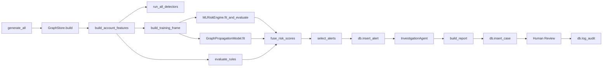

# Technical Documentation

> **AegisGraph — Agentic AI Financial-Crime Investigation System**
> Version 1.0 | August 2026

---

## Table of Contents

1. [System Overview](#1-system-overview)
2. [Data Flow](#2-data-flow)
3. [Module Reference](#3-module-reference)
4. [API Reference](#4-api-reference)
5. [Database Schema](#5-database-schema)
6. [Configuration](#6-configuration)
7. [Testing](#7-testing)
8. [Deployment](#8-deployment)
9. [Security](#9-security)

---

## 1. System Overview

AegisGraph is an end-to-end financial-crime investigation platform built as a monorepo with a FastAPI backend and Next.js frontend.

```
┌─────────────────────────────────────────────────────────────────────┐
│                         Client (Browser)                            │
│                  Next.js 16 + React 19 + Tailwind                   │
└──────────────────────────────┬──────────────────────────────────────┘
                               │ REST / Static
                               ▼
┌─────────────────────────────────────────────────────────────────────┐
│                      FastAPI Gateway (main.py)                       │
│  Serves API + static frontend | CORS | Lifecycle hooks              │
├──────────┬──────────┬──────────┬──────────┬──────────┬──────────────┤
│  Module  │  Module  │  Module  │  Module  │  Module  │   Module     │
│  Data    │   Graph  │ Feature  │  Rule +  │   ML +   │  Pattern     │
│ Generator│  Store   │Engineering│  Graph   │ GNN-lite │Detectors     │
├──────────┴──────────┴──────────┤ Fusion   ├──────────┴──────────────┤
│     Investigation Agent        │  Engine  │   Regulatory RAG       │
├─────────────────────────────────┴──────────┴───────────────────────┤
│          Explainability + Report Generator                           │
├─────────────────────────────────────────────────────────────────────┤
│     Human Review (Approve / Reject / Escalate)                       │
├─────────────────────────────────────────────────────────────────────┤
│                    Audit Ledger (SQLite)                             │
└─────────────────────────────────────────────────────────────────────┘
```

### Runtime Components

| Component | Technology | Purpose |
|-----------|-----------|---------|
| API Gateway | FastAPI 0.141 | REST endpoints, static file serving, lifecycle |
| Graph Store | NetworkX 3.2 | Transaction network construction and expansion |
| Feature Engineering | pandas + NumPy | Behavioral feature computation |
| Rule Engine | Pure Python | Deterministic compliance rule checks |
| ML Risk Engine | scikit-learn | RandomForest baseline with benchmarked metrics |
| GNN-lite | NumPy | Message-passing propagation model |
| Pattern Detectors | NetworkX + DFS | Typology detection (smurfing, layering, etc.) |
| Investigation Agent | OpenAI SDK | LLM-planned tool-calling agent |
| Regulatory RAG | scikit-learn TF-IDF | Compliance note retrieval |
| Explainability | Pure Python | Evidence chains and feature deviation |
| Report Generator | Jinja2 | Structured markdown reports |
| Database | SQLite3 | Case, alert, and audit persistence |

---

## 2. Data Flow



### Pipeline Phases

| Phase | Input | Output | Module |
|-------|-------|--------|--------|
| 1. Data Generation | Config params | customers, accounts, transactions | `data_generator.py` |
| 2. Graph Construction | Transaction data | NetworkX DiGraph | `graph_store.py` |
| 3. Feature Engineering | Graph + transactions | Feature DataFrame | `feature_engineering.py` |
| 4. Rule Engine | Features + accounts | Rule scores DataFrame | `rule_engine.py` |
| 5. Pattern Detection | Graph + transactions | Pattern flags per account | `pattern_detectors.py` |
| 6. ML Training | Features + ground truth | Trained RandomForest + metrics | `ml_risk_engine.py` |
| 7. GNN-lite | Graph + features | Graph propagation scores | `graph_propagation_model.py` |
| 8. Risk Fusion | Rule + ML + Graph scores | Fused risk DataFrame + alerts | `risk_fusion.py` |
| 9. Persistence | Alerts | SQLite records | `db.py` |
| 10. Investigation | Alert ID | Structured report | `investigation_agent.py` |
| 11. Report Generation | Investigation result | Markdown report | `report_generator.py` |
| 12. Human Review | Case ID | Decision (approve/reject/escalate) | Frontend + API |

---

## 3. Module Reference

### 3.1 Data Generator (`data_generator.py`)

Generates a synthetic financial network with injected typologies.

- **Customers**: 260 entities with KYC profiles
- **Accounts**: 400 accounts across customers
- **Transactions**: 2,200 normal + injected suspicious patterns
- **Typologies Injected**:
  - Smurfing: 6 groups (many small senders → intermediate → forward)
  - Layering: 6 chains (A → B → C → D → E rapid movement)
  - Funnel: 6 groups (many senders converge on one account)
  - Fan-out: 6 groups (one source distributes to many)
  - Circular: 5 cycles (A → B → C → A)

**Ground truth** labels are embedded in transaction data (`is_suspicious_ground_truth`) for ML training and evaluation.

### 3.2 Graph Store (`graph_store.py`)

Builds and queries the transaction network.

- **Nodes**: Accounts with attributes (type, country, risk_level, etc.)
- **Edges**: Transactions with attributes (amount, timestamp, currency)
- **Operations**:
  - `build(customers, accounts, tx)` → NetworkX DiGraph
  - `expand_network(account_id, hops)` → Subgraph for visualization
  - `to_cytoscape_json(subgraph)` → Frontend-compatible JSON
  - `transaction_edges(subgraph)` → Filtered edge list

### 3.3 Feature Engineering (`feature_engineering.py`)

Computes per-account behavioral features:

| Feature | Description |
|---------|-------------|
| `total_inflow` | Sum of incoming transaction amounts |
| `total_outflow` | Sum of outgoing transaction amounts |
| `net_flow` | inflow - outflow |
| `tx_count` | Number of transactions |
| `unique_counterparties` | Number of distinct connected accounts |
| `avg_tx_amount` | Average transaction amount |
| `max_tx_amount` | Largest single transaction |
| `velocity_amount_per_hour` | Amount moved per hour |
| `in_degree` | Number of incoming connections |
| `out_degree` | Number of outgoing connections |
| `pass_through_ratio` | Fraction of funds passed through quickly |

### 3.4 Rule Engine (`rule_engine.py`)

Applies deterministic compliance rules:

| Rule | Trigger Condition |
|------|------------------|
| Velocity | >$X moved in <30 minutes |
| Structuring | Transactions within 8% below reporting threshold |
| Rapid Movement | Funds held <15 minutes before forwarding |
| High Counterparty Count | Connected to >4 unique accounts |
| Unusual Activity | Statistical outlier on key features |

### 3.5 ML Risk Engine (`ml_risk_engine.py`)

- **Model**: RandomForestClassifier (scikit-learn)
- **Features**: Engineered features + rule scores + pattern flags
- **Training**: 75% train / 25% test split, stratified
- **Output**: Probability scores + benchmarked metrics
- **Metrics**: Precision, Recall, F1, ROC-AUC, PR-AUC

### 3.6 Graph Propagation Model (`graph_propagation_model.py`)

GNN-lite implementation using NumPy message passing:

- **Architecture**: 3-hop label propagation with LogisticRegression classifier
- **Input**: Propagated features from graph neighbors
- **Output**: Probability scores per account
- **Rationale**: CPU-only, no PyTorch dependency, instant execution

### 3.7 Pattern Detectors (`pattern_detectors.py`)

Graph-topology and temporal pattern detection:

| Detector | Algorithm | Priority |
|----------|-----------|----------|
| Funnel | In-degree concentration + temporal clustering | 0 |
| Fan-out | Out-degree concentration + temporal clustering | 1 |
| Layering | Chain detection (A→B→C→D) with rapid movement | 2 |
| Smurfing | Many-to-one-to-many with small amounts | 3 |
| Circular Flow | Cycle detection (max length 6) | 4 |

### 3.8 Risk Fusion (`risk_fusion.py`)

Combines three risk signals into a single score:

```
combined_risk = 0.30 * rule_score + 0.40 * ml_score + 0.30 * graph_score
```

| Risk Level | Threshold |
|------------|-----------|
| HIGH | combined_risk >= 0.60 |
| MEDIUM | 0.30 <= combined_risk < 0.60 |
| LOW | combined_risk < 0.30 |

### 3.9 Investigation Agent (`investigation_agent.py`)

Dual-mode investigation engine:

**Deterministic Mode** (default, no API key):
- Fixed tool call sequence
- Reproducible, auditable
- Automatic fallback on any failure

**Agentic Mode** (requires API key):
- LLM receives tool registry (`AGENT_TOOL_SCHEMAS`)
- Model decides turn-by-turn which tool to call
- Adaptive investigation paths per account
- Budget cap: 10 tool calls max
- Backfill guarantee: required fields filled deterministically if skipped

**Tool Registry**:

| Tool | Purpose |
|------|---------|
| `get_account_profile` | Fetch account metadata and owners |
| `expand_network` | Multi-hop subgraph expansion (1-4 hops) |
| `calculate_velocity` | Behavioral feature retrieval |
| `detect_patterns` | Typology pattern detection |
| `run_risk_models` | Rule + ML + graph fused scores |
| `search_regulations` | TF-IDF regulatory note retrieval |
| `generate_evidence_summary` | Explainability + evidence chain |
| `finish_investigation` | Agentic-only: signal investigation complete |

### 3.10 Regulatory RAG (`regulatory_rag.py`)

- **Corpus**: 5 original compliance reference notes
- **Retrieval**: TF-IDF vectorization + cosine similarity
- **Query**: Pattern names or general suspicious behavior query
- **Production upgrade**: Swap for `sentence-transformers` + Qdrant

### 3.11 Explainability (`explainability.py`)

Generates evidence chains:

- Rule match details with thresholds
- Pattern findings with evidence
- Feature deviation from population statistics (z-scores)
- Plain-language reasoning for each signal

### 3.12 Report Generator (`report_generator.py`)

Structured markdown report with sections:

1. Case metadata
2. Account profile
3. Risk scores (rule, ML, graph, fused)
4. Pattern findings
5. Regulatory context
6. Evidence chain
7. Executive summary
8. Agent investigation log (if agentic mode)
9. Senior review pass (if configured)

### 3.13 Database (`db.py`)

SQLite persistence layer:

- **Tables**: alerts, cases, audit_log
- **Operations**: CRUD for cases and alerts, append-only audit trail
- **Production upgrade**: PostgreSQL with Alembic migrations

---

## 4. API Reference

### Base URL

```
http://localhost:8000
```

### Endpoints

| Method | Path | Description |
|--------|------|-------------|
| GET | `/api/dashboard` | Dashboard summary statistics |
| POST | `/api/rebuild` | Regenerate data and rerun pipeline |
| GET | `/api/alerts` | List all alerts |
| GET | `/api/alerts/{alert_id}` | Get specific alert |
| GET | `/api/graph/{account_id}?hops=N` | Get subgraph for visualization |
| POST | `/api/investigate/{alert_id}` | Run investigation on alert |
| GET | `/api/cases` | List all cases |
| GET | `/api/cases/{case_id}` | Get case details |
| POST | `/api/cases/{case_id}/review` | Submit human review decision |
| GET | `/api/cases/{case_id}/audit` | Get audit trail for case |

### Request/Response Examples

#### POST /api/investigate/{alert_id}

**Response**:
```json
{
  "case_id": "CASE-A1B2C3D4",
  "account_id": "ACC-001",
  "risk": {
    "rule_score": 0.75,
    "ml_score": 0.82,
    "graph_score": 0.68,
    "combined_risk": 0.76,
    "risk_level": "HIGH"
  },
  "patterns": [
    {
      "pattern": "funnel",
      "confidence": 0.92,
      "evidence": ["8 senders concentrated", "temporal clustering detected"]
    }
  ],
  "regulations": [
    {
      "title": "Structuring and Smurfing",
      "content": "...",
      "score": 0.85
    }
  ],
  "explanation": {
    "reasons": [...],
    "summary": "..."
  },
  "network_graph": {
    "elements": [...]
  },
  "markdown_report": "# Investigation Report\n..."
}
```

---

## 5. Database Schema

### alerts

```sql
CREATE TABLE alerts (
    alert_id TEXT PRIMARY KEY,
    account_id TEXT NOT NULL,
    combined_risk REAL NOT NULL,
    rule_score REAL NOT NULL,
    ml_score REAL NOT NULL,
    graph_score REAL NOT NULL,
    risk_level TEXT NOT NULL,
    status TEXT DEFAULT 'NEW',
    created_at TIMESTAMP DEFAULT CURRENT_TIMESTAMP
);
```

### cases

```sql
CREATE TABLE cases (
    case_id TEXT PRIMARY KEY,
    alert_id TEXT NOT NULL,
    report_json TEXT NOT NULL,
    decision TEXT,
    decision_notes TEXT,
    created_at TIMESTAMP DEFAULT CURRENT_TIMESTAMP,
    updated_at TIMESTAMP DEFAULT CURRENT_TIMESTAMP
);
```

### audit_log

```sql
CREATE TABLE audit_log (
    id INTEGER PRIMARY KEY AUTOINCREMENT,
    case_id TEXT NOT NULL,
    actor TEXT NOT NULL,
    action TEXT NOT NULL,
    details TEXT,
    timestamp TIMESTAMP DEFAULT CURRENT_TIMESTAMP
);
```

---

## 6. Configuration

All tunable parameters are centralized in `config.py`.

```python
# Data Generation
N_CUSTOMERS = 260
N_ACCOUNTS = 400
N_NORMAL_TRANSACTIONS = 2200
N_SMURFING_GROUPS = 6
N_LAYERING_CHAINS = 6
N_FUNNEL_GROUPS = 6
N_FANOUT_GROUPS = 6
N_CYCLES = 5
STRUCTURING_THRESHOLD = 10000
RANDOM_SEED = 42

# Rule Engine
RULE_VELOCITY_WINDOW_MINUTES = 30
RULE_MIN_COUNTERPARTIES_FOR_FLAG = 4
RULE_STRUCTURING_MARGIN = 0.08
RULE_RAPID_HOLDING_SECONDS = 900

# Pattern Detectors
PATTERN_FUNNEL_MIN_SENDERS = 4
PATTERN_FANOUT_MIN_RECEIVERS = 4
PATTERN_SMURFING_MIN_HOPS = 3
PATTERN_MAX_CYCLE_LENGTH = 6
PATTERN_TIME_WINDOW_MINUTES = 60

# ML / Graph
GNN_PROPAGATION_HOPS = 3
ML_TEST_SIZE = 0.25

# Risk Fusion
FUSION_WEIGHTS = {"rule": 0.30, "ml": 0.40, "graph": 0.30}
HIGH_RISK_THRESHOLD = 0.60

# Agentic AI
GROQ_API_KEY = os.environ.get("GROQ_API_KEY")
OPENROUTER_API_KEY = os.environ.get("OPENROUTER_API_KEY")
AGENT_MAX_TOOL_CALLS = 10
```

### Environment Variables

| Variable | Required | Purpose |
|----------|----------|---------|
| `GROQ_API_KEY` | No | Enable agentic mode via Groq |
| `OPENROUTER_API_KEY` | No | Enable agentic mode via OpenRouter |
| `ANTHROPIC_API_KEY` | No | Enable agentic mode via Anthropic |
| `OPENROUTER_MODEL` | No | Model identifier for OpenRouter |
| `GROQ_MODEL` | No | Model identifier for Groq |

---

## 7. Testing

### Test Suite

| Test File | Coverage |
|-----------|----------|
| `test_pattern_detectors.py` | Unit tests for each typology detector |
| `test_pipeline.py` | Full pipeline integration test |
| `test_agentic_investigation.py` | Agentic mode tests (mocked LLM) |
| `test_adversarial_simulator.py` | Adversarial evasion simulation |
| `test_unsupervised_anomaly.py` | Unsupervised anomaly detection |

### Running Tests

```bash
cd backend
pytest tests/ -v
```

### CI/CD

The project uses GitHub Actions for automated testing on every push to `main`.

---

## 8. Deployment

### Docker Compose (Recommended)

```bash
docker compose up --build
```

Services defined in `docker-compose.yml`:

| Service | Image | Ports | Purpose |
|---------|-------|-------|---------|
| aegisgraph-api | Custom Dockerfile | 8000:8000 | FastAPI + frontend |

### Production Upgrade Path

| Component | Current | Production |
|-----------|---------|------------|
| Graph DB | NetworkX (in-memory) | Neo4j 5 |
| Primary DB | SQLite | PostgreSQL 16 |
| Vector Search | TF-IDF | Qdrant + neural embeddings |
| GNN | NumPy message passing | PyTorch Geometric |
| Streaming | Batch + REST | Kafka |
| Orchestration | Docker Compose | Kubernetes |

---

## 9. Security

- **No secrets in code**: API keys loaded from environment variables only
- **CORS**: Configured for development; restrict origins in production
- **Input validation**: Pydantic models for all request bodies
- **SQL injection prevention**: Parameterized queries via SQLite3
- **Agent safety**: LLM can only call tools in fixed, auditable registry
- **Budget caps**: Hard limit on agent tool calls prevents runaway loops
- **Deterministic fallback**: System always produces complete investigation even on LLM failure
- **Audit trail**: Every action logged with actor, timestamp, and details

---

*Generated for AegisGraph v1.0 — August 2026*
